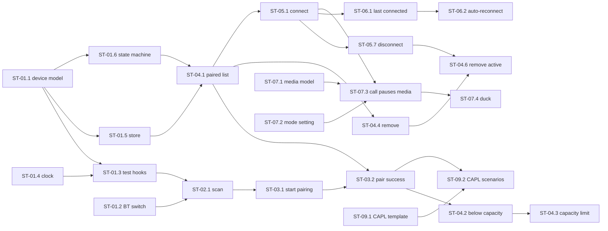

# SmartDrive IVI Bluetooth Simulator - Epics, Stories and Subtasks

Source: `docs/SmartDrive_IVI_Specification_1_Bluetooth_Connectivity.md` (SRS v1.1).

## 1. Conventions

**Sizing (only S, M, L are allowed; anything larger is split).**

| Size | Meaning |
|------|---------|
| S | One behaviour, 1-3 acceptance criteria, one component, no new test hook needed. |
| M | One behaviour with several outcomes or boundaries, or touches two components. |
| L | One cohesive capability with multiple outcomes and a new hook or state; still verifiable in a single story. |

**Rules**

- Each story is independently testable via the simulator test hooks (EP-01); stories list only *hard* dependencies.
- **Dependency notation:** `Depends on` = must be built/available before the story can be implemented or tested. Subtask IDs use `ST-x.y.n`; a subtask depends on earlier subtasks of the same story unless stated. A story cannot start until all its `Depends on` stories are done; blocked stories additionally wait for the named OQ.
- Dependencies are acyclic at story level; section 6 shows the build waves and cross-epic graph.
- Every story traces to an SRS ID (FR/NFR/DOC/UC).
- `Q-xx` decisions from SRS section 14 are used as default behaviour (pending owner confirmation).
- Stories marked **BLOCKED (OQ-xx)** depend on an open question in SRS section 10. Behaviour is not assumed; the story holds a placeholder AC until the owner answers.
- Subtasks are listed only where the story has distinct implementation or verification work.

## 2. Epic overview

| Epic | Title | Trace | Stories |
|------|-------|-------|---------|
| EP-01 | Simulator core and test hooks | NFR-BT-004, NFR-BT-005, SRS 4, 7 | 6 |
| EP-02 | Device discovery | FR-BT-001 | 5 |
| EP-03 | Pairing and pairing failures | FR-BT-002, FR-BT-007 | 9 |
| EP-04 | Paired-device list, capacity and removal | FR-BT-003, FR-BT-006 | 7 |
| EP-05 | Connection management | FR-BT-004, FR-BT-006 | 8 |
| EP-06 | Automatic reconnection | FR-BT-005 | 7 |
| EP-07 | Incoming-call interruption | FR-BT-008 | 10 |
| EP-08 | Non-functional quality | NFR-BT-001..004 | 4 |
| EP-09 | CAPL supplementary scripts | DOC-CAPL-001..003, NFR-BT-005 | 4 |

Suggested order: follow the build waves in section 6 (epic order is a guide only; EP-03, EP-04 and EP-05 interleave).

---

## EP-01 Simulator core and test hooks

Goal: a controllable software simulator that all other epics can be tested against.

### ST-01.1 Simulated device model and fixtures - S
- **Trace:** SRS 4 (1, 2), NFR-BT-005
- **Depends on:** none
- **AC:**
  - Each device has unique ID, display name and 6-digit numeric passkey (Q-03), all synthetic.
  - Fixtures load from `test-data/bluetooth-devices.json`.
  - Duplicate device IDs in a fixture are rejected on load.
- **Subtasks:**

  | ID | Subtask | Depends on |
  |----|---------|------------|
  | ST-01.1.1 | Define device schema | none |
  | ST-01.1.2 | Create fixture file with >= 7 devices (to exercise the 5-device limit) | ST-01.1.1 |
  | ST-01.1.3 | Loader with validation (duplicate IDs) | ST-01.1.1, ST-01.1.2 |

### ST-01.2 Bluetooth enable/disable switch - S
- **Trace:** SRS 4 (6)
- **Depends on:** none
- **AC:** Bluetooth state is on/off, defaults to a documented value, and can be toggled via API; current state is queryable.

### ST-01.3 Test hooks for availability, passkey validity, delays and outcomes - M
- **Trace:** NFR-BT-005, SRS 4 (3)
- **Depends on:** ST-01.1 (device IDs), ST-01.4 (delays use the clock)
- **AC:**
  - Hooks exist to set per-device availability, accept/reject behaviour, passkey validity, operation delay and connection outcome (success, failure, timeout, disconnection).
  - Hooks can be reset to defaults between tests.
  - Unknown device ID in a hook returns an explicit error.
- **Subtasks:**

  | ID | Subtask | Depends on |
  |----|---------|------------|
  | ST-01.3.1 | Availability hook | ST-01.1 |
  | ST-01.3.2 | Accept/reject and passkey-validity hook | ST-01.1 |
  | ST-01.3.3 | Delay hook | ST-01.4 |
  | ST-01.3.4 | Connection outcome hook | ST-01.1 |
  | ST-01.3.5 | Reset/fixture teardown | ST-01.3.1-ST-01.3.4 |

### ST-01.4 Controllable clock - S
- **Trace:** SRS 4 (7, 8)
- **Depends on:** none
- **AC:** Time can be advanced programmatically; default pairing timeout is 30 s and is configurable.

### ST-01.5 Persistent store for paired list and last connected device - M
- **Trace:** Q-18, FR-BT-003, FR-BT-005
- **Depends on:** ST-01.1 (device IDs)
- **AC:**
  - Paired list and last connected device are saved after each change.
  - A simulated restart reloads both.
  - A corrupt or missing store starts as empty without crashing.

### ST-01.6 Device state machine - M
- **Trace:** SRS 7, 7.1
- **Depends on:** ST-01.1
- **AC:**
  - States: Not discovered, Discovered, Pairing, Paired, Connecting, Connected, Disconnected, Pairing failed, plus Removed.
  - Only the transitions in 7.1 are permitted; any other transition is rejected with an error.
  - Current state is queryable per device.
- **Subtasks:**

  | ID | Subtask | Depends on |
  |----|---------|------------|
  | ST-01.6.1 | Transition table | none |
  | ST-01.6.2 | Guard for invalid transitions | ST-01.6.1 |

---

## EP-02 Device discovery

### ST-02.1 Scan lists discoverable devices - M
- **Trace:** FR-BT-001, UC-BT-001 steps 1-2
- **Depends on:** ST-01.1, ST-01.2, ST-01.3
- **AC:**
  - With Bluetooth on, starting a scan displays the devices returned by the simulator.
  - Each entry shows name and distinguishable device ID.
  - Scan completes when the simulator returns its list (Q-01).

### ST-02.2 No duplicate entries - S
- **Trace:** FR-BT-001
- **Depends on:** ST-02.1
- **AC:** If the simulator returns the same device ID twice in one scan, it is shown once.

### ST-02.3 No-devices-found message - S
- **Trace:** FR-BT-001, Q-01
- **Depends on:** ST-02.1
- **AC:** An empty simulator list shows a "no devices found" message and no device entries.

### ST-02.4 Scan blocked when Bluetooth is off - S
- **Trace:** FR-BT-001
- **Depends on:** ST-02.1 (scan action), ST-01.2
- **AC:** Scan request while off does not start a scan and shows a message that Bluetooth must be enabled.

### ST-02.5 Hide already-paired devices from results - S
- **Trace:** FR-BT-001, Q-02
- **Depends on:** ST-02.1, ST-01.5 (paired list seeded from the store, not via pairing)
- **AC:** Devices in the paired list do not appear in scan results.

---

## EP-03 Pairing and pairing failures

### ST-03.1 Start pairing and show passkey step - M
- **Trace:** FR-BT-002, UC-BT-001 steps 3-5
- **Depends on:** ST-02.1 (discovered device), ST-01.6 (state machine)
- **AC:**
  - User selects a discovered device and starts pairing; device state becomes Pairing.
  - Passkey verification step is displayed.
  - Pairing start for an undiscovered device is rejected.

### ST-03.2 Successful pairing with correct passkey - M
- **Trace:** FR-BT-002, UC-BT-001 steps 6-9
- **Depends on:** ST-03.1, ST-01.5 (store), ST-04.1 (list shows result)
- **AC:**
  - Correct passkey and device accepts -> state Paired, device appears in paired list, success status shown.
  - Passkey format is 6 digits; non-numeric or wrong-length input is rejected as invalid.

### ST-03.3 Pairing fails on wrong passkey - S
- **Trace:** FR-BT-002, FR-BT-007, Q-04
- **Depends on:** ST-03.1
- **AC:** Wrong passkey ends the attempt immediately; state Pairing failed; error message shown; device not in paired list.

### ST-03.4 Pairing fails on device rejection - S
- **Trace:** FR-BT-002, FR-BT-007
- **Depends on:** ST-03.1, ST-01.3 (reject hook)
- **AC:** Correct passkey but device rejects -> Pairing failed, error shown, device not paired.

### ST-03.5 Pairing timeout at 30 s - M
- **Trace:** FR-BT-007, Q-22, Q-23, SRS 9 (BVA)
- **Depends on:** ST-03.1, ST-01.4 (clock)
- **AC:**
  - Timer starts when the passkey step is shown.
  - Passkey entered at 29.9 s and 30.0 s is accepted; at 30.1 s the attempt is cancelled.
  - Timeout shows a distinct timeout message; state Pairing failed; device not paired.
  - A configured non-default timeout is honoured.

### ST-03.6 Retry pairing after failure - S
- **Trace:** FR-BT-007, Q-24
- **Depends on:** ST-03.3, ST-03.4, ST-03.5 (one failure path each)
- **AC:** After wrong passkey, rejection or timeout, a new pairing attempt can start immediately; no attempt limit or wait.

### ST-03.7 Block already-paired device - S
- **Trace:** FR-BT-002, Q-05
- **Depends on:** ST-03.1, ST-01.5 (paired list seeded from the store)
- **AC:** Pairing a device already in the paired list is blocked with an "already paired" message; list unchanged.

### ST-03.8 Reject concurrent pairing request - S
- **Trace:** FR-BT-002, Q-06
- **Depends on:** ST-03.1
- **AC:** A second pairing request while one is in progress is rejected with a message; the first attempt is unaffected.

### ST-03.9 Pairing cancel and device disappearance - M - **BLOCKED (OQ-05, OQ-08)**
- **Trace:** FR-BT-007, UC-BT-001
- **Depends on:** ST-03.1, ST-01.3; **waits for:** OQ-05, OQ-08
- **AC (placeholder):**
  - OQ-08: whether and how the user can cancel pairing before the timeout - final state and message TBD.
  - OQ-05: device disappears during passkey verification - final state and error handling TBD.
- **Subtasks:**

  | ID | Subtask | Depends on |
  |----|---------|------------|
  | ST-03.9.1 | Cancel-pairing hook | ST-03.1, ST-01.3 |
  | ST-03.9.2 | Device-disappears-during-pairing hook | ST-03.1, ST-01.3 |
  | ST-03.9.3 | Expected results and tests for cancel | ST-03.9.1; OQ-08 answered |
  | ST-03.9.4 | Expected results and tests for disappearance | ST-03.9.2; OQ-05 answered |

  Do not implement expected results (ST-03.9.3, ST-03.9.4) until answered.

---

## EP-04 Paired-device list, capacity and removal

### ST-04.1 Paired-device list view - S
- **Trace:** FR-BT-002, FR-BT-004, NFR-BT-004
- **Depends on:** ST-01.5, ST-01.6
- **AC:** Paired devices are listed with name, ID and current state (Paired / Connecting / Connected / Disconnected).

### ST-04.2 Pairing allowed below capacity - S
- **Trace:** FR-BT-003
- **Depends on:** ST-03.2
- **AC:** With 0-4 devices stored, pairing a 1st-5th device succeeds.

### ST-04.3 Capacity check at device selection - M
- **Trace:** FR-BT-003, Q-09, UC-BT-001 alt flow
- **Depends on:** ST-04.2 (pairing up to the limit), ST-03.1 (selection step)
- **AC:**
  - With 5 devices stored, selecting a device for pairing is blocked before the passkey step.
  - A message explains the paired-device limit has been reached.
  - A 6th device is never added; list stays at 5.
  - Boundary counts 4, 5 and 6 are all verifiable.

### ST-04.4 Remove paired device - S
- **Trace:** FR-BT-006, Q-20
- **Depends on:** ST-04.1
- **AC:** Removing a non-connected paired device deletes it from the list; it is no longer paired; a status message is shown without a confirmation prompt.

### ST-04.5 Pair again after removal at capacity - S
- **Trace:** FR-BT-003
- **Depends on:** ST-04.3, ST-04.4
- **AC:** With 5 stored, removing one allows pairing of another device; list ends at 5.

### ST-04.6 Remove the active or connecting device - M
- **Trace:** FR-BT-006, Q-21
- **Depends on:** ST-04.4 (remove), ST-05.1 (connect), ST-05.7 (disconnect)
- **AC:**
  - Removing the Connected device disconnects it, then removes it.
  - Removing a Connecting device cancels the attempt and the device returns to Paired before removal.
  - No orphaned connection remains.

### ST-04.7 Capacity counting rules - S - **BLOCKED (OQ-04)**
- **Trace:** FR-BT-003
- **Depends on:** ST-04.3; **waits for:** OQ-04
- **AC (placeholder):** Whether unavailable or previously paired devices count towards the limit of 5 - TBD.

---

## EP-05 Connection management

### ST-05.1 Connect a paired device - M
- **Trace:** FR-BT-004, UC-BT-002
- **Depends on:** ST-04.1 (paired device), ST-01.2, ST-01.3 (outcome hook), ST-01.6
- **AC:**
  - Paired device with no active connection goes Paired -> Connecting -> Connected on success.
  - Connected state and a success message are shown in the list.

### ST-05.2 Connection failure or unavailable device - S
- **Trace:** FR-BT-004, UC-BT-002 alt flow
- **Depends on:** ST-05.1
- **AC:** Failure or unavailable device -> device returns to Paired/Disconnected; message "connection could not be established"; paired list unchanged.

### ST-05.3 Connection blocked when Bluetooth is off - S
- **Trace:** UC-BT-002 alt flow
- **Depends on:** ST-05.1, ST-01.2
- **AC:** Connect request while off is prevented and the user is informed.

### ST-05.4 Connection timeout at 30 s - M
- **Trace:** FR-BT-004, Q-12
- **Depends on:** ST-05.1, ST-01.4 (clock)
- **AC:** No response within 30 s -> attempt ends, device returns to Paired, timeout message shown; boundary at 29.9/30.0/30.1 s verifiable.

### ST-05.5 Connect request for already Connected or Connecting target - S
- **Trace:** FR-BT-004, Q-11
- **Depends on:** ST-05.1
- **AC:**
  - Target already Connected: no state change, status shown.
  - Another device Connecting: new request rejected until it finishes.

### ST-05.6 Second connection while another is active - M - **BLOCKED (OQ-01)**
- **Trace:** FR-BT-004, UC-BT-002 alt flow
- **Depends on:** ST-05.1, ST-05.5, ST-05.7 (needed if OQ-01 resolves to auto-disconnect); **waits for:** OQ-01
- **AC (placeholder):**
  - Invariant (known): never two Connected devices at once; outcome message shown; list reflects true state.
  - TBD: auto-disconnect the first device vs. require manual disconnect.

### ST-05.7 Disconnect the active device - S
- **Trace:** FR-BT-006
- **Depends on:** ST-05.1
- **AC:** Disconnect moves the device Connected -> Disconnected; it stays in the paired list; status feedback shown.

### ST-05.8 Unexpected disconnection event - S
- **Trace:** SRS 4 (3), SRS 7.1, NFR-BT-004
- **Depends on:** ST-05.1, ST-01.3 (disconnection outcome hook)
- **AC:** A simulator disconnection event moves the active device to Disconnected and updates the list and status message.

---

## EP-06 Automatic reconnection

### ST-06.1 Record last connected device - S
- **Trace:** FR-BT-005
- **Depends on:** ST-05.1, ST-01.5
- **AC:** After a successful connection, that device is stored as last connected; a later connection replaces it.

### ST-06.2 Auto-reconnect on Bluetooth enable - M
- **Trace:** FR-BT-005
- **Depends on:** ST-06.1, ST-01.2, ST-01.3 (availability hook)
- **AC:** Enabling Bluetooth with the last connected device available starts reconnection, shows reconnection status, and ends Connected on success.

### ST-06.3 Device unavailable during reconnect - S
- **Trace:** FR-BT-005
- **Depends on:** ST-06.2
- **AC:** Last connected device unavailable -> system stays Disconnected and shows an appropriate status.

### ST-06.4 No reconnect to removed or manually disconnected device - S
- **Trace:** FR-BT-005, Q-16, Q-19
- **Depends on:** ST-06.1, ST-05.7 (manual disconnect), ST-04.4 (remove)
- **AC:**
  - Manual disconnect clears last connected; enabling Bluetooth does not reconnect.
  - Removed device clears last connected; no reconnection attempt.

### ST-06.5 Manual connection stops reconnection - S
- **Trace:** FR-BT-005, Q-17
- **Depends on:** ST-06.2, ST-05.1
- **AC:** A manual connect to a device during reconnection stops the reconnection and proceeds with the manual request.

### ST-06.6 Reconnect after restart - M
- **Trace:** FR-BT-005, Q-18
- **Depends on:** ST-06.2, ST-01.5 (persistence)
- **AC:** After simulated restart, paired list and last connected device persist; reconnection restarts when Bluetooth is on and the device is available.

### ST-06.7 Retry count, interval and reconnection window - M - **BLOCKED (OQ-02, OQ-03)**
- **Trace:** FR-BT-005
- **Depends on:** ST-06.2, ST-01.4 (clock); **waits for:** OQ-02, OQ-03
- **AC (placeholder):** Retry count, interval and maximum duration - TBD. Provide configurable parameters only; no default asserted.

---

## EP-07 Incoming-call interruption

Notes: media playback is simulated by a minimal media-state model (playing/paused/ducked, volume).

### ST-07.1 Simulated media playback model - S
- **Trace:** FR-BT-008, NFR-BT-005
- **Depends on:** ST-01.3 (hook framework)
- **AC:** Media state (playing, paused, ducked), volume level and a hook to start/stop playback are available and queryable.

### ST-07.2 Interruption mode setting - S
- **Trace:** FR-BT-008, Q-26
- **Depends on:** none
- **AC:** Setting has values `pause` and `duck`, default `pause`; invalid values are rejected.

### ST-07.3 Incoming call pauses media - M
- **Trace:** FR-BT-008
- **Depends on:** ST-07.1, ST-07.2, ST-05.1 (Connected device is the call source; introduces call-event handling used by ST-07.4-07.10)
- **AC:** In `pause` mode, an incoming-call event from the Connected device during playback pauses media and shows the call indication.

### ST-07.4 Incoming call ducks media - M
- **Trace:** FR-BT-008, Q-27
- **Depends on:** ST-07.3
- **AC:** In `duck` mode, volume becomes 30% of current volume; original volume is restored when the interruption ends.

### ST-07.5 Call indication without media - S
- **Trace:** FR-BT-008, Q-32
- **Depends on:** ST-07.3
- **AC:** Incoming-call indication is shown even when no media is playing; media state unchanged.

### ST-07.6 Call end events end the interruption - S
- **Trace:** FR-BT-008, Q-30
- **Depends on:** ST-07.3
- **AC:** Answered-then-ended, rejected and missed events each end the interruption and clear the indication.

### ST-07.7 Ignore calls from non-connected devices - S
- **Trace:** FR-BT-008, Q-31
- **Depends on:** ST-07.3, ST-04.1 (a second, paired but not connected device)
- **AC:** Call event from a paired but non-connected device changes nothing (no indication, no media change).

### ST-07.8 Connection lost during a call - S
- **Trace:** FR-BT-008
- **Depends on:** ST-07.3, ST-05.8
- **AC:** Disconnection during a call updates the connection status and the device state to Disconnected.

### ST-07.9 Media resumption policy after call - M - **BLOCKED (OQ-06)**
- **Trace:** FR-BT-008
- **Depends on:** ST-07.4, ST-07.6 (pause and duck paths, call end); **waits for:** OQ-06
- **AC (placeholder):**
  - Known: playback is not resumed if policy or user setting prevents it.
  - TBD: whether media resumes automatically after every call; default policy value.

### ST-07.10 Bluetooth disabled during an active call - S - **BLOCKED (OQ-07)**
- **Trace:** FR-BT-008
- **Depends on:** ST-07.3, ST-01.2; **waits for:** OQ-07
- **AC (placeholder):** Interruption and recovery behaviour - TBD.

---

## EP-08 Non-functional quality

### ST-08.1 Visible feedback within 2 seconds - M
- **Trace:** NFR-BT-001
- **Depends on:** ST-01.3, ST-01.4 (delay hook, clock), ST-02.1, ST-03.2, ST-04.4, ST-05.1, ST-05.7 (the actions measured)
- **AC:** For scan, pair, connect, disconnect and remove, visible feedback appears within 2 s of the action, excluding the simulated device delay (measured with the controllable clock/delay hook).

### ST-08.2 Status message coverage - M
- **Trace:** NFR-BT-002
- **Depends on:** ST-02.4, ST-03.3, ST-03.4, ST-03.5, ST-04.3, ST-05.2, ST-05.3 (stories that produce the failure messages)
- **AC:** A clear, distinct message exists for scanning, pairing, connecting, disconnecting and each failure condition (wrong passkey, rejection, timeout, capacity, BT off, connection failure).
- **Subtasks:**

  | ID | Subtask | Depends on |
  |----|---------|------------|
  | ST-08.2.1 | Message catalogue | none |
  | ST-08.2.2 | Check each message is reachable by a test hook | ST-08.2.1, stories listed above |

### ST-08.3 Paired list integrity after failures - M
- **Trace:** NFR-BT-003
- **Depends on:** ST-01.5, ST-02.1, ST-03.3, ST-03.4, ST-03.5, ST-05.2
- **AC:** After a failed scan, pairing or connection attempt, the paired list and last connected device are identical to their state before the attempt.

### ST-08.4 Displayed vs. underlying state consistency - M
- **Trace:** NFR-BT-004
- **Depends on:** ST-04.1, ST-01.6, ST-02.1, ST-03.2, ST-04.4, ST-05.1, ST-05.7, ST-06.6, ST-07.3 (one story per operation checked)
- **AC:** After each completed operation (scan, pair, connect, disconnect, remove, call, restart) the displayed state equals the simulator's internal state for every device.

---

## EP-09 CAPL supplementary scripts

Supplement only; the Python/Pytest suite is primary. Scripts live under `tests/capl/`.

### ST-09.1 CAPL script header and citation template - S
- **Trace:** DOC-CAPL-001, DOC-CAPL-002
- **Depends on:** none
- **AC:** Template header records CANoe version (e.g. `CANoe 17 SP3`) and a citation list (Vector help/KB entry) per built-in function.

### ST-09.2 CAPL pairing and connection scenarios - L
- **Trace:** NFR-BT-005, FR-BT-002, FR-BT-004
- **Depends on:** ST-09.1, ST-01.3, ST-03.2, ST-03.3, ST-05.1, ST-05.7 (simulator behaviour the scripts exercise)
 the simulator for successful pairing, wrong passkey, and connect/disconnect, each citing every non-standard CAPL function used.
- **Subtasks:**

  | ID | Subtask | Depends on |
  |----|---------|------------|
  | ST-09.2.1 | Pairing success script | ST-09.1, ST-03.2 |
  | ST-09.2.2 | Pairing failure script | ST-09.1, ST-03.3 |
  | ST-09.2.3 | Connect/disconnect script | ST-09.1, ST-05.1, ST-05.7 |
  | ST-09.2.4 | Header and citation check per script | ST-09.2.1, ST-09.2.2, ST-09.2.3 |

### ST-09.3 CAPL citation compliance check - S
- **Trace:** DOC-CAPL-001, DOC-CAPL-002, DOC-CAPL-003
- **Depends on:** ST-09.1, ST-09.2
- **AC:** Every CAPL script is checked for version header, a citation per built-in function, and no forum/blog as sole source.

### ST-09.4 CAPL scripts for blocked behaviours - S - **BLOCKED (OQ-01..OQ-08)**
- **Trace:** SRS 6.1
- **Depends on:** ST-09.1, ST-03.9, ST-04.7, ST-05.6, ST-06.7, ST-07.9, ST-07.10 (each CAPL test mirrors one blocked story); **waits for:** OQ-01..OQ-08
- **AC:** Any CAPL test depending on OQ-01..OQ-08 is marked blocked and linked to its clarification question.

---

## 3. Open-question blocking summary

| OQ | Blocks | Stories |
|----|--------|---------|
| OQ-01 | Second smartphone while one is active | ST-05.6 |
| OQ-02 | Reconnection retry count | ST-06.7 |
| OQ-03 | Retry interval and reconnection window | ST-06.7 |
| OQ-04 | Does the 5-device limit include unavailable devices | ST-04.7 |
| OQ-05 | Device disappears during passkey verification | ST-03.9 |
| OQ-06 | Resume after every call | ST-07.9 |
| OQ-07 | Bluetooth disabled during an active call | ST-07.10 |
| OQ-08 | Cancel pairing before timeout | ST-03.9 |
| OQ-01..08 | CAPL tests that depend on them | ST-09.4 |

## 4. Requirement traceability

| Requirement | Stories |
|-------------|---------|
| FR-BT-001 | ST-02.1-02.5 |
| FR-BT-002 | ST-03.1-03.4, 03.7, 03.8, 04.1 |
| FR-BT-003 | ST-04.2, 04.3, 04.5, 04.7 |
| FR-BT-004 | ST-05.1, 05.2, 05.4, 05.5, 05.6 |
| FR-BT-005 | ST-06.1-06.7 |
| FR-BT-006 | ST-04.4, 04.6, 05.7 |
| FR-BT-007 | ST-03.3-03.6, 03.9 |
| FR-BT-008 | ST-07.1-07.10 |
| NFR-BT-001 | ST-08.1 |
| NFR-BT-002 | ST-08.2 |
| NFR-BT-003 | ST-08.3 |
| NFR-BT-004 | ST-01.6, ST-08.4 |
| NFR-BT-005 | ST-01.1-01.4, ST-09.2 |
| DOC-CAPL-001..003 | ST-09.1, 09.3 |
| UC-BT-001 | ST-03.1, 03.2, 04.3 |
| UC-BT-002 | ST-05.1-05.3 |

## 5. Size summary

| Size | Count |
|------|-------|
| S | 36 |
| M | 23 |
| L | 1 |

## 6. Dependency view

### 6.1 Build waves

A story can start once every story in an earlier wave that it depends on is done; stories in the same wave are independent of each other and can run in parallel. Wave = longest dependency chain to the story.

| Wave | Stories (and subtasks) |
|------|------------------------|
| W0 | ST-01.1, ST-01.2, ST-01.4, ST-07.2, ST-09.1; subtask ST-08.2.1 |
| W1 | ST-01.3, ST-01.5, ST-01.6 |
| W2 | ST-02.1, ST-04.1, ST-07.1 |
| W3 | ST-02.2, ST-02.3, ST-02.4, ST-02.5, ST-03.1, ST-04.4, ST-05.1 |
| W4 | ST-03.2, ST-03.3, ST-03.4, ST-03.5, ST-03.7, ST-03.8, ST-03.9, ST-05.2, ST-05.3, ST-05.4, ST-05.5, ST-05.7, ST-05.8, ST-06.1, ST-07.3 |
| W5 | ST-03.6, ST-04.2, ST-04.6, ST-05.6, ST-06.2, ST-06.4, ST-07.4, ST-07.5, ST-07.6, ST-07.7, ST-07.8, ST-07.10, ST-08.1, ST-08.3, ST-09.2 |
| W6 | ST-04.3, ST-06.3, ST-06.5, ST-06.6, ST-06.7, ST-07.9, ST-09.3 |
| W7 | ST-04.5, ST-04.7, ST-08.2, ST-08.4 |
| W8 | ST-09.4 |

Longest chain (critical path): ST-01.1 -> ST-01.3 -> ST-02.1 -> ST-03.1 -> ST-03.2 -> ST-04.2 -> ST-04.3 -> ST-04.7 -> ST-09.4.

Blocked stories (ST-03.9, 04.7, 05.6, 06.7, 07.9, 07.10, 09.4) can be built up to their hooks and placeholders in their wave, but their expected results wait for the OQ answer.

### 6.2 Cross-epic dependencies

At epic level EP-03/EP-04 and EP-04/EP-05 reference each other; the story-level graph below is acyclic.

### 6.3 Blocked-story dependencies

| Blocked story | Depends on stories | Waits for |
|---------------|--------------------|-----------|
| ST-03.9 | ST-03.1, ST-01.3 | OQ-05, OQ-08 |
| ST-04.7 | ST-04.3 | OQ-04 |
| ST-05.6 | ST-05.1, ST-05.5, ST-05.7 | OQ-01 |
| ST-06.7 | ST-06.2, ST-01.4 | OQ-02, OQ-03 |
| ST-07.9 | ST-07.4, ST-07.6 | OQ-06 |
| ST-07.10 | ST-07.3, ST-01.2 | OQ-07 |
| ST-09.4 | ST-09.1 + the blocked stories above | OQ-01..OQ-08 |
